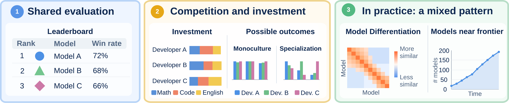

# Strategic Competition and Convergence in LLM Leaderboards



This repository contains the implementation for the paper “Strategic
Competition and Convergence in LLM Leaderboards.”

This work was done by [Naveen Raman](https://naveenraman.com/), [Fei Fang](https://feifang.info/), and [Yiling Chen](https://yiling.seas.harvard.edu/).

**Paper:** arXiv link coming soon

#### TL;DR

Leaderboards are a popular way to compare large language model (LLM)
capabilities and can influence how model developers invest resources. We ask
when competition on leaderboards leads developers to produce models with
similar capability profiles, which we call monoculture, or similar performance
levels. We study this by formulating leaderboard competition as a game in which
model developers invest resources across capabilities to maximize their win
rate. We show that similar production functions can induce similar capability
profiles, while comparative advantage can sustain distinct capability profiles.
We then study convergence in performance levels and show that diminishing
returns can lead to an increasingly crowded competitive frontier. Using data
from LM Arena and OpenRouter, we find that developers improve more in
categories where they lag competitors, while still retaining category-specific
advantages. At the same time, we find that the frontier of models becomes
increasingly crowded, alongside increasingly diversified model usage patterns.
Our results suggest that increasing competition does not need to produce
interchangeable models, but can instead sustain competitive models with
distinct strengths.

## Data

We rely on two sources of data: leaderboards from LM Arena and usage data from
OpenRouter.

We use LM Arena to construct leaderboards and better understand how capability
profiles evolve over time. We construct a panel covering 422 models from 59
organizations and 28 categories, using the
“lmarena-ai/leaderboard-dataset” from March 2024 through September 2026. Each
snapshot contains 28 category-level Elo ratings, along with rating variances
and vote counts. Of these 28 categories, we focus on 8 (coding, math, hard
prompts, instruction following, creative writing, longer query, multi-turn,
and English) because these categories are consistently available since 2024.

To measure realized model usage, we use daily OpenRouter traffic data from
January 2025 through September 2026. The data cover 408 models over 620 days.
We aggregate token shares to the model and developer levels to study how
changes in the evaluated model frontier correspond to changes in realized model
usage. We detail how we match data from OpenRouter up with data from LM Arena in
the analysis code.

## Setup

Install the Python dependencies used by the scripts:

```bash
python3 -m pip install numpy pandas pyarrow requests huggingface_hub \
    scipy matplotlib
```

Fetch the data. Existing files are kept unless `--force` is supplied:

```bash
python3 scripts/fetch_data.py
python3 scripts/fetch_data.py --force
```

The leaderboard data are public. The OpenRouter data require an API key:

```bash
export OPENROUTER_API_KEY=...
python3 scripts/fetch_data.py
```

Generate all figures in `plots/`:

```bash
python3 scripts/make_figures.py --figure all
```

To generate one figure, pass its name instead of `all`, for example:

```bash
python3 scripts/make_figures.py --figure gap_vs_dtheta
```

## Repository layout

```text
scripts/
    common.py             shared panel loading and estimation utilities
    similarity.py         capability-profile similarity and null models
    catchup.py            catch-up regressions and robustness checks
    crowding.py           frontier crowding and usage calculations
    or_arena_match.py     OpenRouter-to-LM-Arena model matching
    fetch_data.py         download and summarize the empirical panels
    make_figures.py       reproduce the paper figures
raw_data/                 downloaded parquet data (not tracked by git)
plots/                    generated figures
paper.pdf                current manuscript
pull_figure.pdf          source for the overview figure
```

## Citation

The citation will be added when the arXiv version is available.

```bibtex
@article{raman2026strategic,
  title   = {Strategic Competition and Convergence in LLM Leaderboards},
  author  = {Raman, Naveen and Fang, Fei and Chen, Yiling},
  year    = {2026},
  note    = {Manuscript forthcoming on arXiv}
}
```

For questions, contact [Naveen Raman](mailto:naveenr@cmu.edu).
